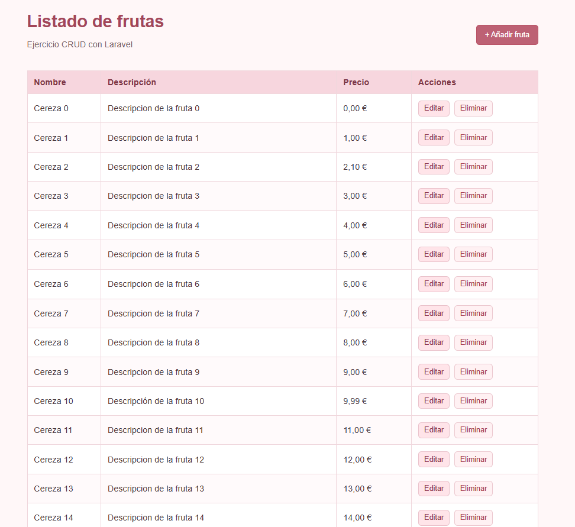
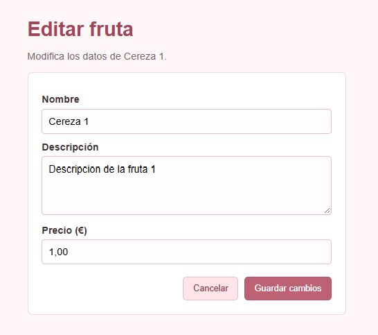
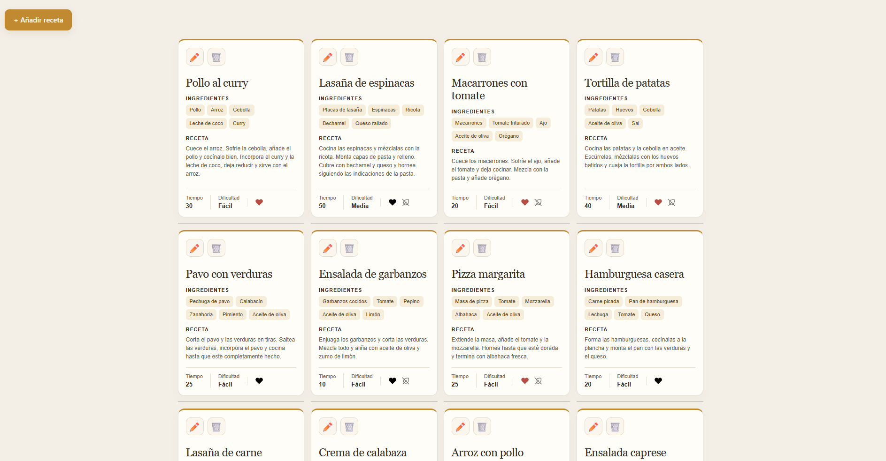
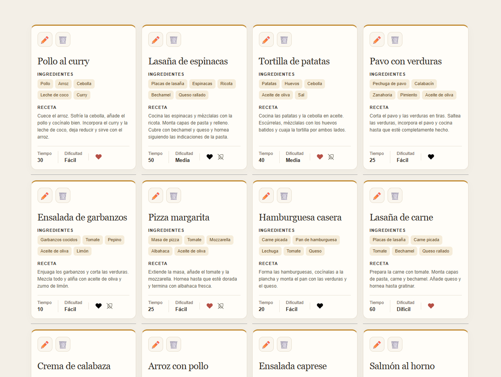
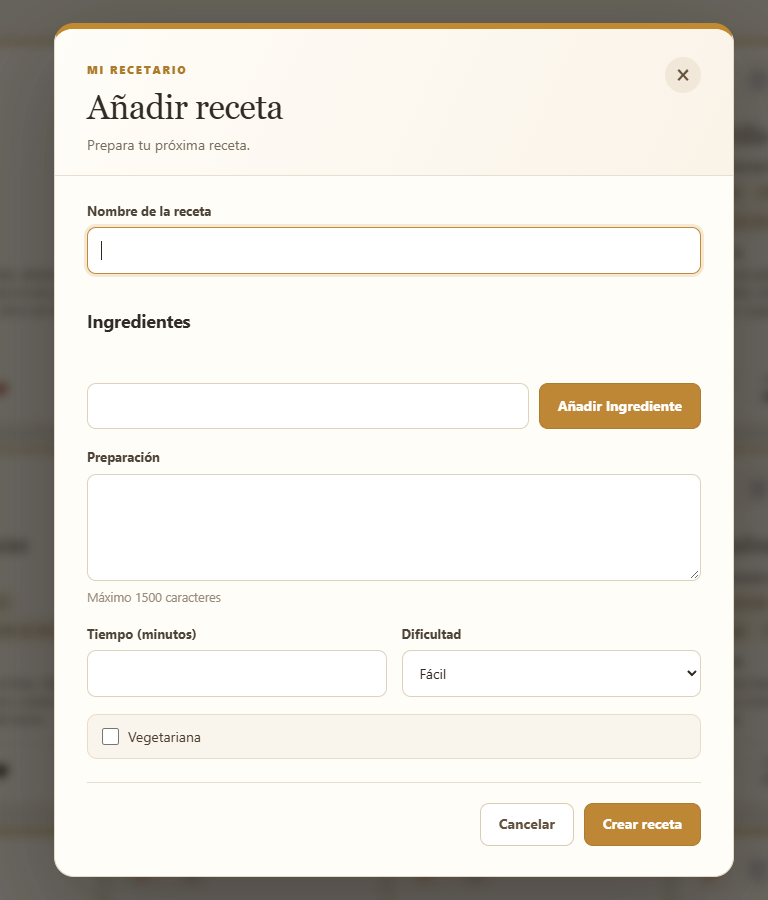
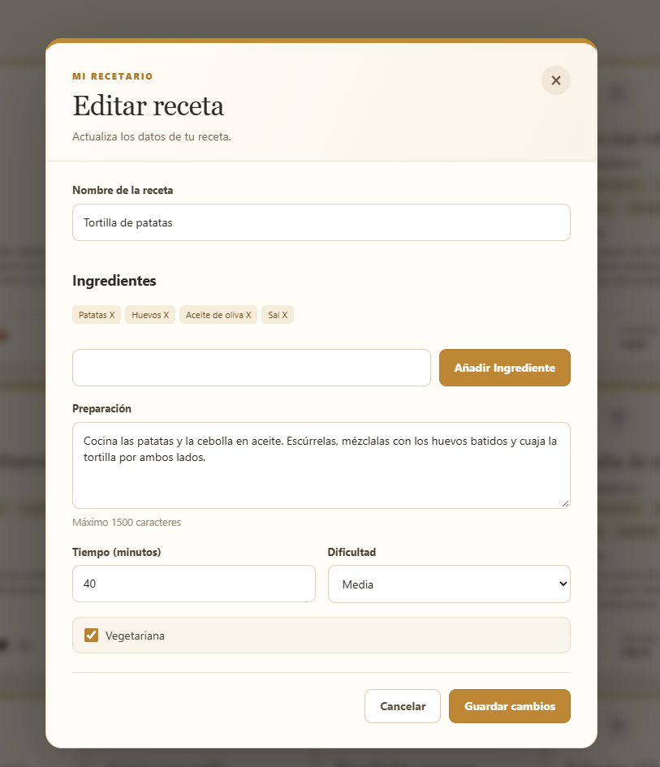
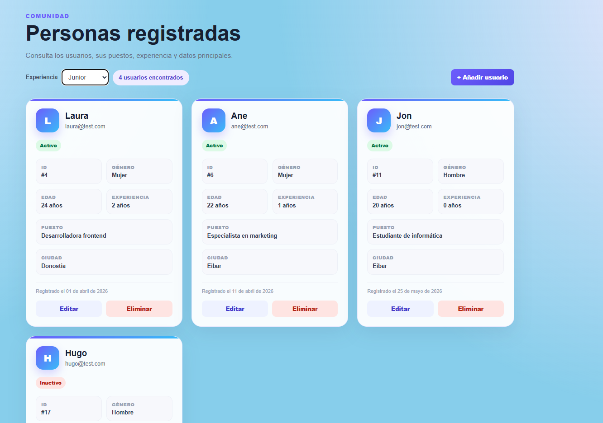
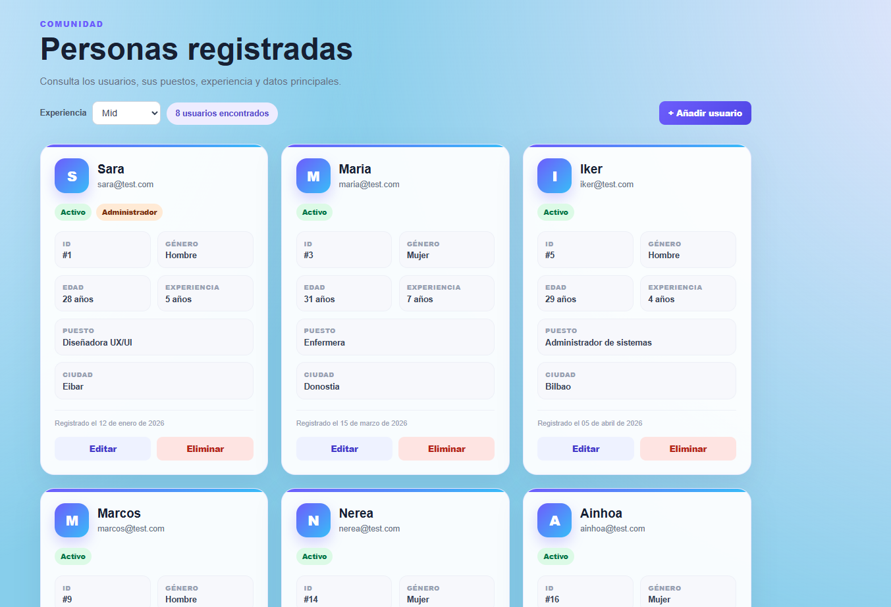
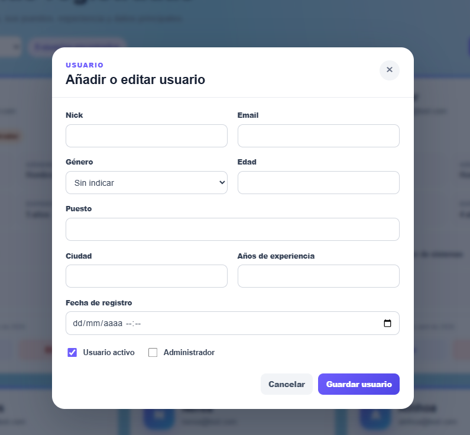
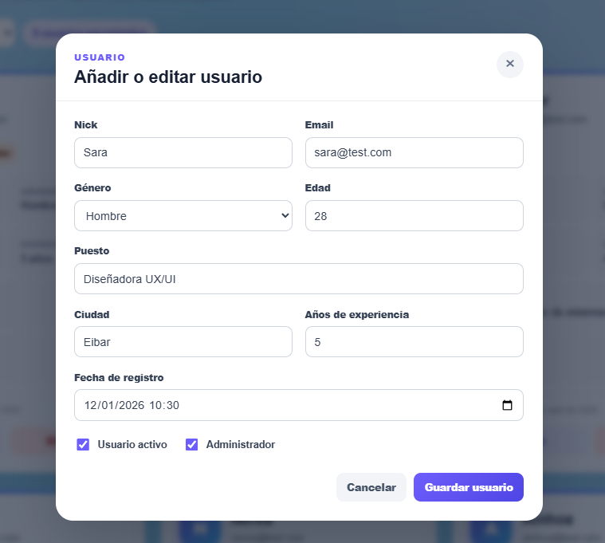

# Curso de desarrollo web — Ejercicios y prácticas

Repositorio con los ejercicios y pequeñas aplicaciones que he realizado durante mi aprendizaje de **desarrollo web**, desde los fundamentos de PHP y SQL hasta prácticas con **Laravel, Symfony y React**.

El contenido está organizado por temas. **No es una única aplicación**: cada carpeta corresponde a ejercicios, pruebas o proyectos de práctica independientes.

## Tecnologías trabajadas

- **Backend:** PHP, Laravel y Symfony.
- **Bases de datos:** SQL y MySQL.
- **Frontend:** HTML, CSS, JavaScript y React.
- **Herramientas:** Composer y entorno local de desarrollo.

## Estructura del repositorio

```text
MasterPHP - Curso/
├── 01-PHP-APARTADO1/               # Ejercicios de PHP
├── 02-SQL-APARTADO1/               # Ejercicios de SQL
├── 03-PHP-SQL/                     # Prácticas que combinan PHP y SQL
├── 4-Aprendiendo-librerias-php/    # Pruebas con librerías de PHP
├── 5-aprendiendo-laravel/          # Ejercicios con Laravel
├── 6-Aprendiendo-symfony-React/    # Prácticas con Symfony y React
├── 6-React-pruebas-de-instalacion/ # Pruebas iniciales de React
├── DIA-Diagrama/                   # Diagramas
├── Readme-capturas/                       # Imágenes para este README
├── .gitignore
└── README.md
```

## Algunas prácticas realizadas

### Laravel — CRUD de frutas

Ejercicio para trabajar operaciones de **crear, consultar, editar y eliminar** registros. La interfaz muestra un listado de frutas con nombre, descripción y precio, además de botones para gestionar cada registro.

**Listado de frutas**



**Formulario de edición**



### React — Recetario

Práctica de interfaz con un **listado de recetas en tarjetas** y formularios para añadir o modificar recetas. En las capturas se ven ingredientes, preparación, tiempo, dificultad y una opción para indicar si una receta es vegetariana.

**Listado de recetas**





**Añadir receta**



**Editar receta**



### Symfony — Gestión de usuarios

Práctica de gestión de usuarios con **tarjetas informativas**, filtro por nivel de experiencia y formularios para añadir o editar los datos. La interfaz muestra campos como nombre, correo, edad, puesto, ciudad, años de experiencia, estado y rol de administrador.

**Listado con filtro por experiencia**





**Añadir y editar usuarios**





## Sobre el repositorio

Este repositorio tiene un propósito **formativo**: conservar mis ejercicios, experimentar con distintas herramientas y mostrar mi evolución en desarrollo web. Por eso es normal encontrar ejemplos sencillos, distintas estructuras y pruebas independientes entre sí.

Para ejecutar una práctica, hay que entrar en su carpeta y revisar sus archivos y dependencias. Algunos ejercicios pueden necesitar un servidor PHP, una base de datos local o instalar dependencias específicas.
